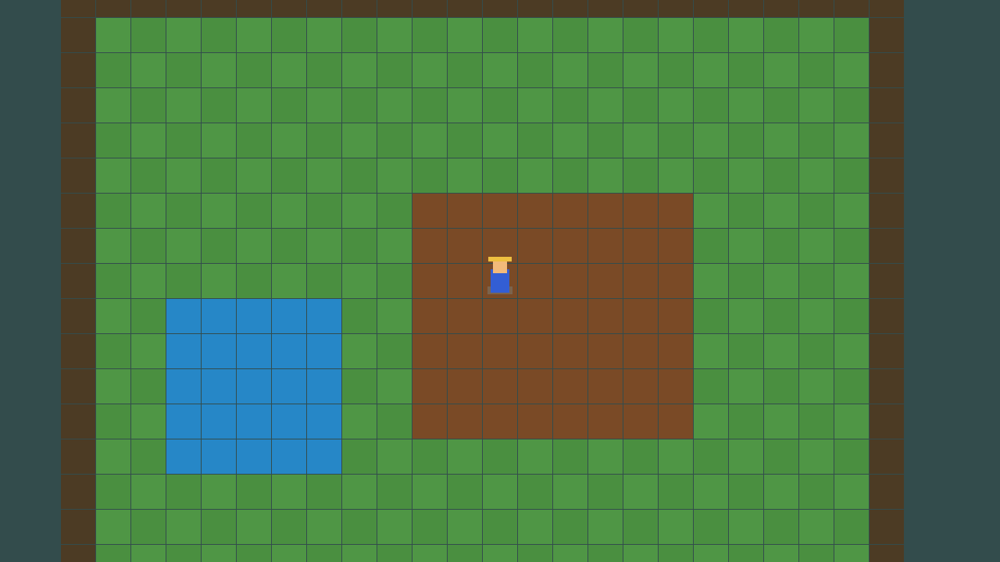
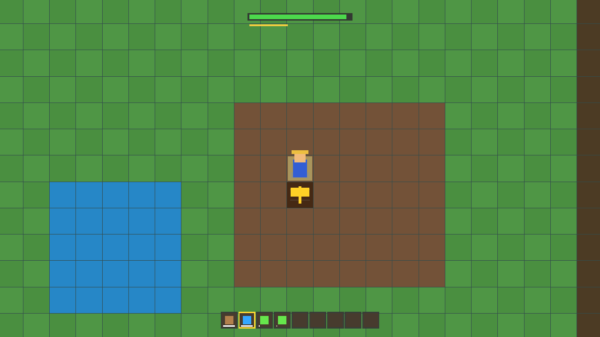
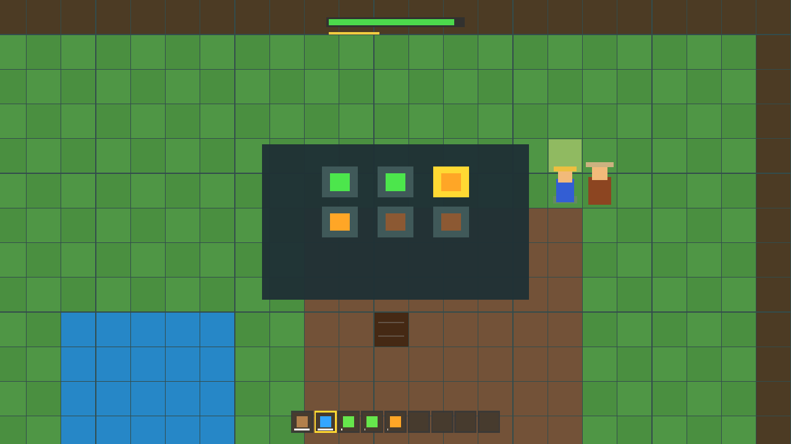
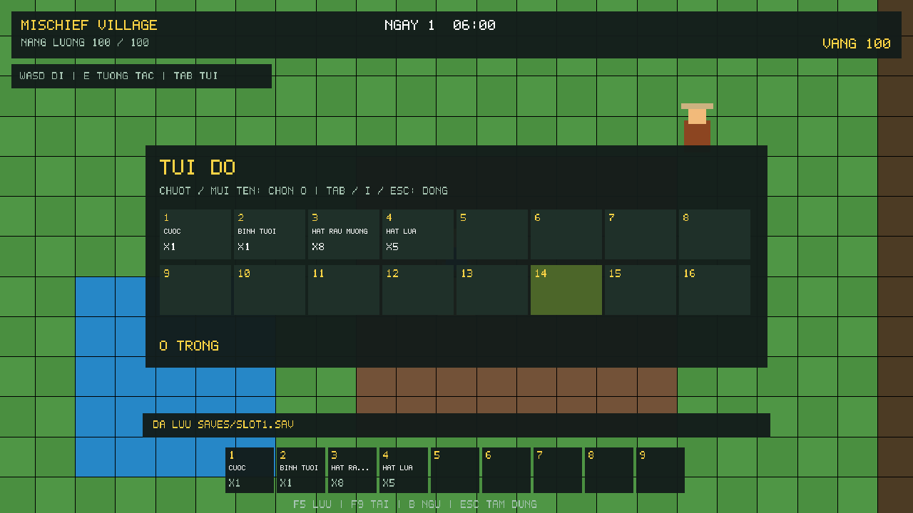
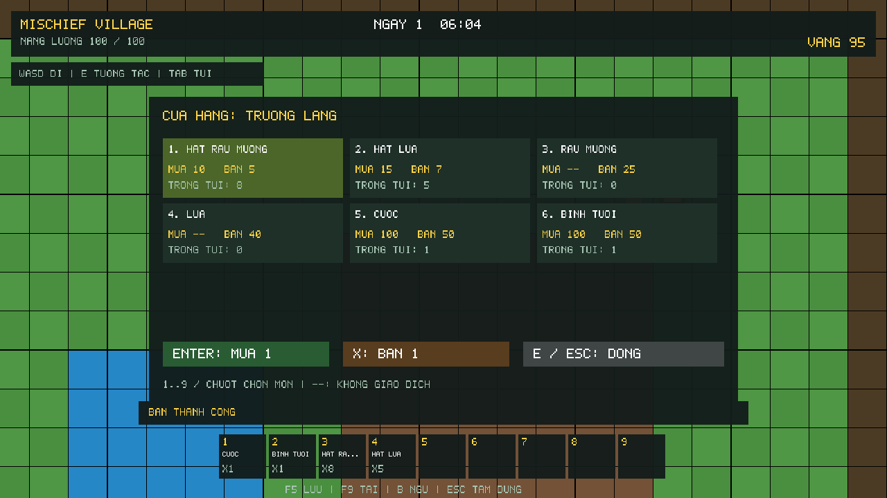
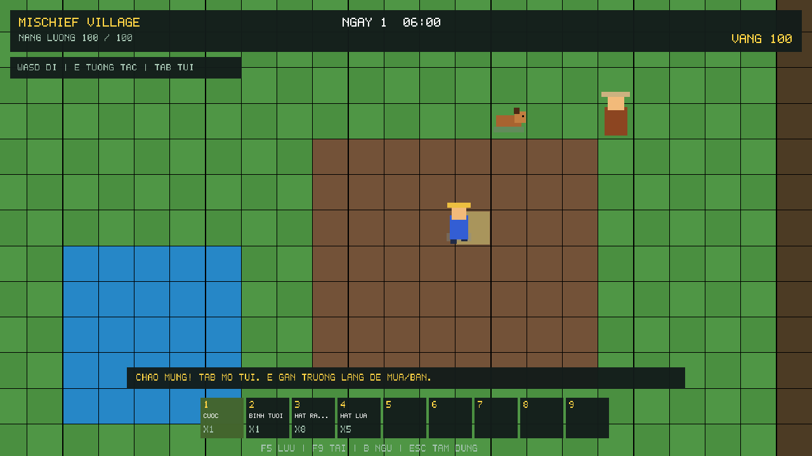

# Tư liệu các giai đoạn từ chat trước

Đã tham khảo đúng các chat liên quan:

- “Giải nén file”: Core01, Render02, Gameplay03, SaveShop04, Audit05, UI06, Sprite07, Visual08, Companion09; đã tìm được MyFarmEngine_All_Updates.zip trên máy.
- “Tạo thư mục snhr”: định hướng hình ảnh 2D đẹp mịn, vui tươi, thư thái; bộ SNHR v11 và nhu cầu cozy assets.
- “Tài liệu lập trình game engine”: lộ trình C++20, đồ họa, input, ECS, lưu game, đa luồng, âm thanh và tối ưu.

Chỉ thu hồi tài nguyên và ảnh xem trước. Không ghi đè mã trong repo bằng code từ các bản ZIP. Tên giai đoạn cũ được dùng để tra cứu, không xem là danh sách chức năng đã hoàn thành của repo hiện tại. Nội dung chat được dùng làm tư liệu, không làm chỉ dẫn thực thi độc lập.

## Ảnh từ archive

Render02 — bản minh họa trước đây:

Gameplay03:

SaveShop04 và Audit05 (hai entry nguồn có thể cùng hình minh họa):

UI06:

Sprite07 và Visual08:

Không tìm thấy PNG xem trước Core01 hoặc Companion09 trong archive được kiểm tra; không tạo ảnh giả làm bằng chứng cho hai mốc đó. Trạng thái thật hiện tại được ghi riêng trong `TIEN_DO.txt` ở gốc repo.
