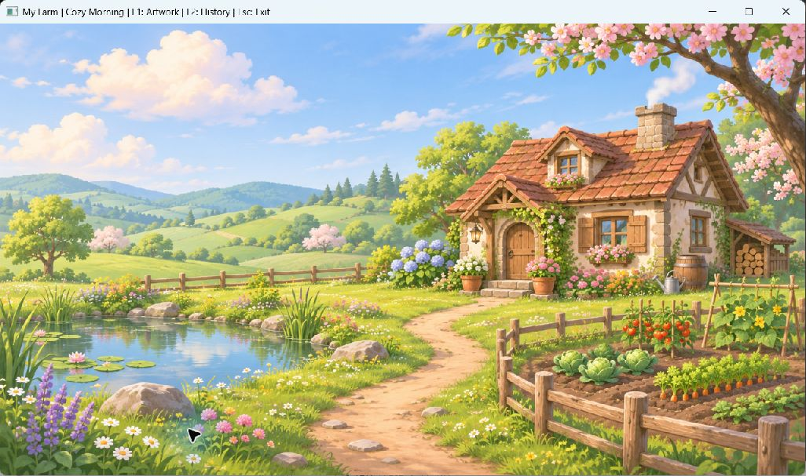
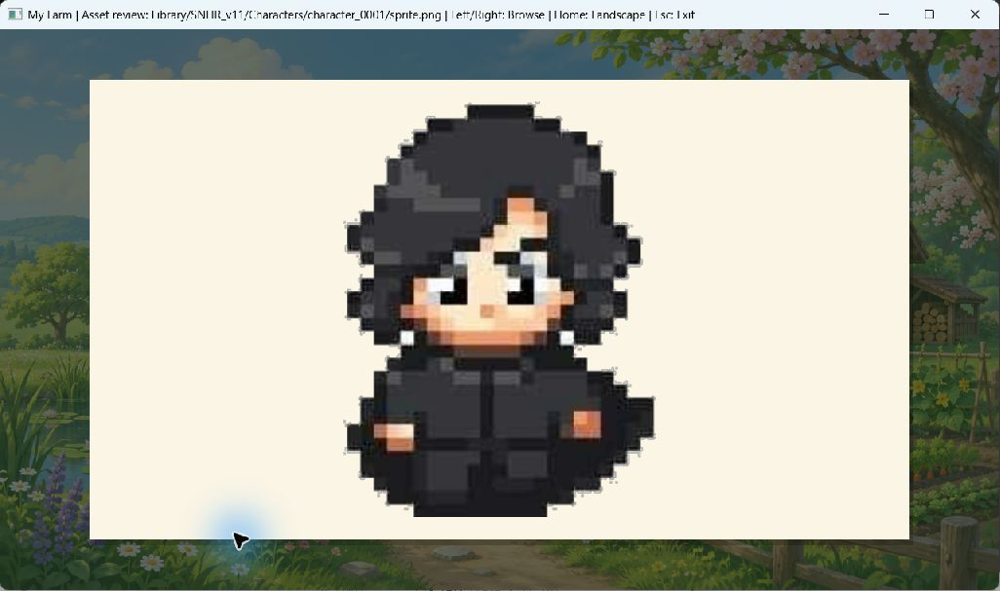
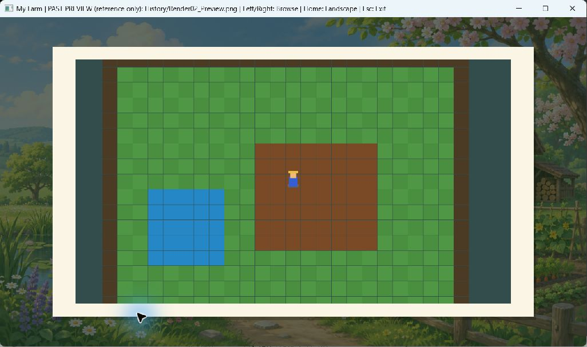

# Tích hợp tài nguyên từ các chat và nền mới

Ngày: 03/11/2026. Đây là phần mở đầu Render02 trên nền engine hiện tại, không phải nhập toàn bộ code Core01–Companion09.

## Đã thực hiện

1. Đọc các chat “Giải nén file”, “Tạo thư mục snhr”, “Tài liệu lập trình game engine”; lấy định hướng cozy/vẽ tay và tên các giai đoạn. Không sao chép các hội thoại không liên quan hoặc coi nội dung chat cũ là lệnh thực thi.
2. Tìm các ZIP đã tải trong Downloads: SNHR v11, SNHR v8, MyFarmEngine_All_Updates. Nhập 177 PNG thư viện, 2 JPG preview và metadata v11; 8 ảnh lịch sử lưu riêng trong Docs/History. Tổng cộng 189 entry từ archive, tất cả khớp SHA256 được ghi lại.
3. Tạo một nền phong cảnh mới bằng imagegen tích hợp; lưu PNG và prompt đầy đủ trong Assets/Backgrounds. Không chỉnh/cắt lại ảnh SNHR hoặc giả lập animation từ những ảnh chưa kiểm tra.
4. Thêm Texture2D: đọc PNG qua đường dẫn Unicode, upload RGBA8 một lần, lọc tuyến tính, clamp mép, kiểm tra giới hạn GPU và giải phóng tài nguyên đúng vòng đời.
5. Thêm Canvas2D: shader GLSL 330, một quad tĩnh dùng lại, vẽ ảnh/khung màu, alpha blending. Chế độ cover cắt phần dư theo tâm, giữ tỉ lệ khi resize; ảnh không bị kéo dãn.
6. Màn hình mặc định hiển thị phong cảnh; F1 xem 5 ảnh đại diện, F2 xem 8 ảnh lịch sử. Phím trái/phải chuyển ảnh, Home về nền, ESC thoát. Tiêu đề cửa sổ ghi đường dẫn ảnh hoặc đánh dấu ảnh lịch sử/chưa tải được.
7. Sửa lỗi input nhấn nhanh bị bỏ lỡ khi chỉ đọc trạng thái hiện tại: dùng callback lưu lần nhấn, consume một lần trong Update. Phím di chuyển liên tục sau này vẫn có thể dùng IsKeyPressed.
8. Build tự chép tài nguyên runtime cạnh EXE; tìm ảnh theo vị trí EXE trên Windows, có fallback về source khi phát triển. Có thể mở từ CMD ở thư mục khác.

## Ảnh kiểm chứng chương trình đang chạy

Đây là ảnh chụp cửa sổ thật bằng computer-use, không phải mockup. Phong cảnh được tạo bằng imagegen; phần khung xem ảnh và xử lý phím là C++/OpenGL.







Ảnh nhân vật/động vật nguồn có thể còn nền/viền/crop chưa hoàn chỉnh. Chế độ review giúp phát hiện chúng; không coi chúng là animation đã sử dụng trong gameplay.

## Kiểm chứng

| Hạng mục | Kết quả |
|---|---|
| Debug build và CTest | 4/4 đạt; lần cuối khoảng 2.44 giây |
| Release build và CTest | 4/4 đạt; lần cuối khoảng 1.75 giây |
| engine.time | Reset, delta giới hạn và độ chính xác clock |
| engine.lifecycle | Vòng đời, resize/viewport, WM_PAINT, cleanup và phím nhấn nhanh |
| game.smoke | Game thật nạp nền và chạy 5 frame thành công |
| engine.canvas | Màu/chiều PNG so với GPU readback, cover cửa sổ rộng/cao, alpha, lỗi file thiếu, dọn texture |
| Toàn vẹn tài nguyên | 189/189 entry khớp SHA256 nguồn |
| Mở từ thư mục khác | Smoke test bằng đường dẫn EXE đầy đủ thành công |
| Giao diện thật | Đã kiểm tra nền, F1, Right, F2, Home; có ba ảnh chụp kèm theo |

GPU kiểm tra: NVIDIA GeForce RTX 3050 Laptop GPU; OpenGL 3.3.0 NVIDIA 566.07. Không còn lỗi chặn EXE trong lần kiểm tra này; không thay đổi chính sách Windows bằng công cụ của lượt làm việc này.

Thời gian CTest không phải FPS hoặc mức cải thiện hiệu năng. Chưa đo benchmark kéo cửa sổ theo thời gian, chưa quay video hoặc kiểm tra nhiều màn hình/DPI khác nhau. Bài test canvas/lifecycle đã kiểm tra phủ kín ảnh, resize và repaint; ảnh chụp không chứng minh mọi frame trong thao tác kéo chuột đều mượt.

## Hiệu năng và cách triển khai

- Nền chỉ decode/upload khi Enter, không đọc đĩa theo từng frame. Đổi lựa chọn gallery mới load ảnh kế tiếp; không giữ cả thư viện trên GPU.
- Một shader và một VBO tĩnh được dùng lại. Màn hình phong cảnh chỉ cần một draw call cho nền; chế độ gallery thêm lớp tối, bóng, khung và ảnh.
- VSync và chờ sự kiện khi minimize của engine vẫn được dùng; callback refresh vẽ lại khi Windows yêu cầu trong lúc kéo/resize, không Update lồng nhau.
- Runtime chỉ dùng tuyến tính và cover crop; chưa có texture atlas, batching, camera thế giới hoặc hệ quản lý tài nguyên đa luồng. Đo profiler trên cảnh gameplay trước khi bổ sung tối ưu phức tạp.
- Copy tài nguyên là target build riêng; không đưa EXE, thư mục out hoặc ZIP gốc vào Git. Khi chia sẻ bản chạy cần giữ thư mục Assets cạnh EXE, không chép riêng mỗi EXE.

## Lệnh dùng lại

PowerShell tại repo:

```powershell
.\Scripts\Build.ps1 -Configuration Debug
.\Scripts\Build.ps1 -Configuration Release
.\Scripts\CheckAssets.ps1
```

CMD ở bất kỳ thư mục nào:

```cmd
D:\my_code\MyFarmEngine\out\build\phase1-debug\MyFarmEngine.exe
```

## Commit và tiến độ

- `ff36f54` — thu hồi ảnh, nền mới, nguồn và file tiến độ.
- `741b782` — renderer PNG/quad và đường dẫn tài nguyên.
- `f70e080` — tích hợp nền, gallery và chép runtime assets.
- `54305ce` — sửa sự kiện nhấn phím ngắn phát hiện từ kiểm tra UI.
- `652a126` — kiểm thử pixel và toàn vẹn tài nguyên.
- Commit tài liệu đi kèm — ảnh chụp thực tế, README, lộ trình và TIEN_DO.txt; hash xem bằng git log.

TIEN_DO.txt ở gốc repo là checklist hiện tại. Các commit có phần mô tả tiến độ và kiểm chứng; xem đầy đủ bằng `git log -6 --format=full`.

Bước tiếp theo: camera trực giao, nhân vật WASD, va chạm/tilemap nhỏ; sau đó mới đến vòng trồng–tưới–thu hoạch. Các ảnh Gameplay03 đến Companion09 từ archive chưa được nhập thành tính năng của repo này.
