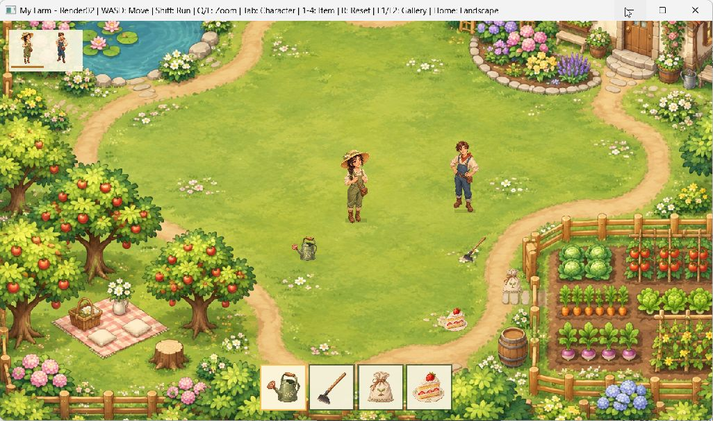
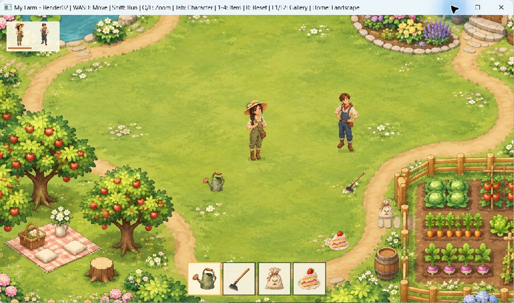
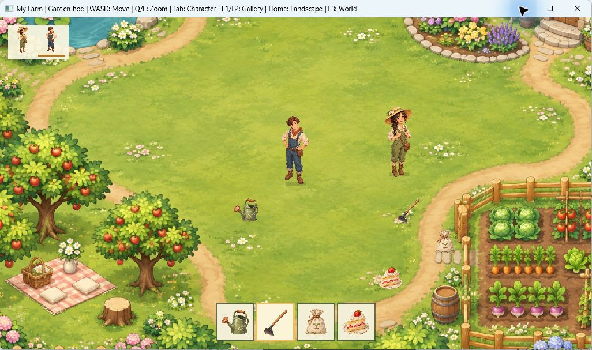

# Giai đoạn 2 — OpenGL, shader, texture, camera và vẽ 2D

Phiên bản: **0.2.0**, cập nhật **03/11/2026**. Phần nền đồ họa và cảnh mẫu di chuyển đã được triển khai trên dự án hiện tại.



## 1. Chạy chương trình

Trong CMD, dùng đường dẫn đầy đủ để không nhầm ổ đĩa:

```cmd
D:\my_code\MyFarmEngine\out\build\phase2-debug\MyFarmEngine.exe
```

Hoặc:

```cmd
cd /d D:\my_code\MyFarmEngine
out\build\phase2-release\MyFarmEngine.exe
```

Đây là thư mục build **phase2**, khác với các EXE phase1 đã tạo trước đó. Game mở thẳng cảnh vườn mới. Khi chép bản chạy sang thư mục/máy khác, giữ cả thư mục Assets cạnh EXE.

## 2. Điều khiển

| Phím | Chức năng |
|---|---|
| W / A / S / D | Di chuyển nhân vật lên / trái / xuống / phải |
| Shift trái | Giữ để chạy nhanh |
| Q / E | Zoom ra / vào; mỗi lần nhấn đổi một mức |
| Tab | Đổi nhân vật điều khiển giữa Linh và An |
| 1 / 2 / 3 / 4 | Chọn bình tưới / cuốc / hạt giống / bánh dâu trên hotbar |
| R | Đặt lại vị trí và camera về trạng thái đầu |
| F1 | Xem ảnh đại diện thư viện cũ |
| F2 | Xem ảnh lịch sử các giai đoạn cũ |
| Trái / phải | Đổi ảnh trong F1/F2 |
| Home | Xem nền phong cảnh cũ |
| F3 | Trở lại cảnh vườn giai đoạn 2 |
| ESC | Thoát |

Hiện 1–4 chỉ chọn ô đang xem, chưa tưới/cuốc/ăn hoặc tiêu hao vật phẩm. Màu viền hotbar và tiêu đề cửa sổ cho biết lựa chọn hiện tại.

## 3. Các phần kỹ thuật đã làm

### OpenGL và shader

GLFW tạo context OpenGL 3.3 core; GLAD nạp các hàm. Renderer dùng một VAO/VBO chứa hai tam giác làm quad, tái sử dụng cho ảnh nền, sprite, atlas và khung UI.

Shader đã tách khỏi chuỗi C++ thành:

- `Assets/Shaders/canvas.vert`: biến đổi hình chữ nhật từ tọa độ thế giới hoặc màn hình sang clip space bằng `viewProjection`.
- `Assets/Shaders/canvas.frag`: đọc RGBA từ texture và nhân màu tint.
- `Engine/Graphics/Shader.*`: đọc file, compile, link, in thông báo lỗi. Nếu thay shader thất bại thì giữ chương trình shader cũ; Reset gọi lại an toàn.

Đường vẽ:

```text
PNG -> decode RGBA -> texture GPU
                           |
quad + rectangle + UV + camera matrix -> vertex shader -> fragment shader -> framebuffer
```

Muốn đổi hiệu ứng, sửa GLSL trong Assets/Shaders, chạy build để chép file mới cạnh EXE, rồi khởi động lại game. Chưa có hot reload trong lúc chạy.

### Texture và sprite atlas

`Texture2D` dùng stb_image có sẵn để đọc PNG, giữ đường dẫn Unicode, upload GL_RGBA8, lọc tuyến tính và clamp mép. Texture được nạp lúc khởi tạo/đổi ảnh; không decode hoặc tạo texture mới mỗi frame. Alpha blending dùng SRC_ALPHA và ONE_MINUS_SRC_ALPHA.

`Canvas2D::Sprite` nhận vùng UV theo dạng `{u, v, width, height}` với gốc ở **góc trên trái**. Atlas mới có bốn ô bằng nhau:

| Vật phẩm | UV |
|---|---|
| Bình tưới | `{0, 0, 0.5, 0.5}` |
| Cuốc | `{0.5, 0, 0.5, 0.5}` |
| Túi hạt | `{0, 0.5, 0.5, 0.5}` |
| Bánh dâu | `{0.5, 0.5, 0.5, 0.5}` |

Vẽ một ô mà không cắt ảnh gốc:

```cpp
canvas.Sprite(items, 100, 100, 64, 64, {0.5f, 0.5f, 0.5f, 0.5f});
```

File JSON cạnh atlas mô tả cùng bốn vùng. Demo hiện dùng hằng số C++ tương ứng; chưa có parser JSON runtime.

### Camera 2D

`Engine/Graphics/Camera2D.h` dùng GLM để tạo ma trận chiếu trực giao. X tăng sang phải, Y tăng xuống dưới; tọa độ player lấy điểm chân. World mẫu rộng 1600, cao 1067 đơn vị. Ở zoom 1, chiều cao nhìn thấy là 720 đơn vị; chiều rộng phụ thuộc aspect ratio cửa sổ.

- `Resize`: cập nhật tỉ lệ khung hình.
- `SetPosition`: đặt tâm, giới hạn trong world.
- `SetZoom`: đổi vùng nhìn; giới hạn zoom-out được nâng theo kích thước world để không lộ dải trống bên ngoài.
- `Follow`: bám player theo hệ số `1-exp(-8*deltaTime)` để giảm phụ thuộc tốc độ khung hình.
- `WorldToScreen` / `ScreenToWorld`: đổi qua lại hai hệ tọa độ, sẵn cho chọn ô bằng chuột sau này.

Thứ tự vẽ hai pass:

```cpp
camera.Resize(width, height);
canvas.BeginWorld(width, height, camera);
// Vẽ map, vật phẩm và nhân vật theo tọa độ thế giới.
canvas.End();
canvas.Begin(width, height);
// Vẽ hotbar và khung chọn nhân vật theo pixel màn hình.
canvas.End();
```

Nhờ hai pass, zoom camera làm cảnh thay đổi nhưng hotbar giữ nguyên kích thước trên màn hình. Hai nhân vật được xếp theo Y của điểm chân để thứ tự che nhau hợp lý.

### Di chuyển và cấu trúc game

`Gameplay/Player/Movement2D.h` chuẩn hóa vector hướng để đi chéo không nhanh hơn. Tốc độ thường là 180 đơn vị/giây, chạy là 300; khoảng dịch chuyển nhân deltaTime của engine. Player được giữ trong biên world. Chưa có va chạm với ao, nhà, cây hoặc NPC.

`Gameplay/World/DemoScene2D.*` quản lý cảnh mẫu, vị trí player, camera, ảnh và hotbar. `GameplayState` chọn giữa cảnh mới, nền cũ và gallery. Shutdown giải phóng tài nguyên GPU khi context vẫn còn sống.

## 4. Bộ ảnh mới

Ảnh tạo bằng **imagegen tích hợp**, lưu ở `Assets/Art`; prompt đầy đủ trong `PROMPTS.txt`, SHA256 trong `manifest.csv`.

- `Characters/farmer_linh.png`: nhân vật nữ, mũ rơm và trang phục xanh lá.
- `Characters/farmer_an.png`: nhân vật nam, yếm xanh và khăn nâu đỏ.
- `Items/farm_items_atlas.png`: bình tưới, cuốc, túi hạt, bánh dâu.
- `World/garden_world.png`: vườn nhìn từ trên xuống, có ao, nhà, luống rau và góc picnic.

Hai nhân vật là **sprite một tư thế** có alpha thật. Chuyển động nhún nhẹ khi đi được tính bằng sin, chưa phải animation frame theo hướng. Nhà/cây/ao trong bản đồ là hình vẽ được ghép sẵn, chưa có layer foreground hoặc dữ liệu tilemap/va chạm.




## 5. Build và kiểm thử

PowerShell tại thư mục repo:

```powershell
.\Scripts\Build.ps1 -Configuration Debug
.\Scripts\Build.ps1 -Configuration Release
.\Scripts\CheckAssets.ps1
```

Script mặc định dùng phase2. Các preset phase1 vẫn được giữ để tương thích tên cũ; chúng build **mã hiện tại**, không phải tự khôi phục source giai đoạn 1. Muốn xem source lịch sử phải tra commit Git.

Trong Developer PowerShell có CMake/Ninja:

```powershell
cmake --preset phase2-debug
cmake --build --preset phase2-debug
ctest --preset phase2-debug
```

Kết quả kiểm tra ngày 03/11/2026, MSVC 19.51, RTX 3050 Laptop GPU:

| Test | Nội dung | Kết quả |
|---|---|---|
| engine.camera | Ma trận, zoom, resize, giới hạn, đổi tọa độ, follow và di chuyển 30/60 bước | Đạt |
| engine.time | DeltaTime và reset | Đạt |
| engine.lifecycle | Vòng đời, repaint Windows, resize, input nhấn nhanh | Đạt |
| game.smoke | Game thật nạp toàn bộ ảnh/shader, chạy 5 frame | Đạt |
| engine.canvas | Pixel PNG, alpha, camera GPU, cả bốn UV atlas, xử lý lỗi shader và cleanup | Đạt |

**Debug 5/5, Release 5/5.** Không có cảnh báo compiler trong build cuối. Đã quan sát trực tiếp cảnh mới, zoom E, Tab đổi nhân vật và phím 2 chọn cuốc, lưu ba ảnh chụp thực tế. Chưa benchmark FPS/CPU hoặc xác nhận trải nghiệm trên GPU/màn hình khác. Thời gian CTest không dùng làm số liệu FPS.

## 6. Tiến độ và phần tiếp theo

Các commit nhỏ theo thứ tự: ảnh mới -> camera/shader -> cảnh mẫu và test logic -> test GPU -> tài liệu/ảnh chụp. Xem `git log -5 --oneline`; `TIEN_DO.txt` ghi checklist hiện tại.

Nền kỹ thuật OpenGL/shader/texture/camera/vẽ 2D của giai đoạn 2 đã hoàn thành trong phạm vi cảnh mẫu. Bước tiếp theo là dữ liệu tilemap và va chạm, animation nhiều hướng, rồi tương tác cuốc–gieo–tưới–thu hoạch. Chọn vật phẩm hiện chưa làm các hành động đó.
