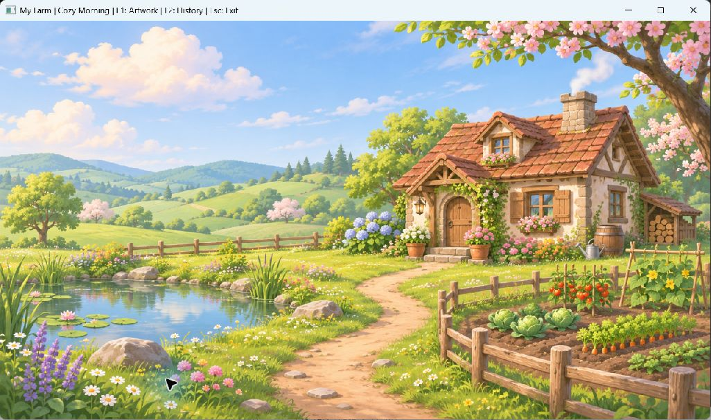

# MyFarmEngine

Engine C++20 dùng GLFW + GLAD/OpenGL cho đồ án game nông trại.

**Trạng thái ngày 03/11/2026: nền engine hoàn tất, đã bắt đầu Render02 với nền PNG và trình xem ảnh.**
Đã thu hồi 177 PNG tài nguyên và 8 ảnh lịch sử từ các ZIP/chat trước; tạo và tích hợp nền nông trại vẽ tay mới. Debug và Release đều đạt 4/4 test trong lần kiểm tra mới nhất. Chưa có bản đồ tương tác, nhân vật điều khiển được hoặc cơ chế trồng cây.



## Build và chạy trên Windows

Cài Visual Studio có **Desktop development with C++** và **C++ CMake tools for Windows**.
GPU/driver phải hỗ trợ OpenGL 3.3 core; test đồ họa cần phiên desktop, không dùng môi trường headless.

Trong PowerShell tại thư mục repo:

```powershell
.\Scripts\Build.ps1 -Configuration Debug
.\out\build\phase1-debug\MyFarmEngine.exe
```

Thoát bằng ESC hoặc nút đóng cửa sổ. Đổi kích thước cửa sổ để kiểm tra viewport.

| Phím | Chức năng |
|---|---|
| F1 | Xem 5 ảnh đại diện các nhóm tài nguyên đã nhập |
| F2 | Xem 8 ảnh lịch sử từ các giai đoạn trong archive cũ |
| Trái / phải | Đổi ảnh trong chế độ xem |
| Home | Quay về phong cảnh |
| ESC | Thoát |

Toàn bộ 177 PNG được lưu trong Assets/Library; F1 chỉ chọn 5 ảnh đại diện, không phải duyệt toàn bộ thư viện. F2 là ảnh chụp quá khứ, không phải gameplay có thể tương tác.

```powershell
# Bản tối ưu hóa và kiểm thử
.\Scripts\Build.ps1 -Configuration Release

# Chỉ test thời gian khi máy không có desktop/OpenGL
.\Scripts\Build.ps1 -Configuration Debug -SkipGraphicsTests

# Tự thoát sau 5 frame; VSync mặc định bật
.\out\build\phase1-debug\MyFarmEngine.exe --smoke-test

# Chỉ dùng khi đo hiệu năng không giới hạn bởi VSync
.\out\build\phase1-debug\MyFarmEngine.exe --no-vsync
```

Nếu PowerShell chặn script, có thể mở Developer PowerShell của Visual Studio với CMake/Ninja trên PATH và dùng các lệnh preset trong tài liệu. Nếu Windows Application Control chặn EXE, việc build thành công không có nghĩa ứng dụng đã chạy được; không tự tắt chính sách bảo mật.

## Tài liệu

- [Giai đoạn 1: thay đổi, cách làm, hiệu năng và kiểm chứng](Docs/GiaiDoan1.md)
- [Lộ trình và tiêu chí hoàn thành giai đoạn tiếp theo](Docs/LoTrinh.md)
- [Tích hợp ảnh, cách làm, hiệu năng và kiểm chứng mới](Docs/TichHopHinhAnh.md)
- [Ảnh các giai đoạn từ chat cũ](Docs/History/README.md)
- [Tiến độ dạng text](TIEN_DO.txt)
- [Nguồn và trạng thái tài nguyên](Assets/README.md)

## Cấu trúc

- `Engine/`: vòng đời ứng dụng, cửa sổ, thời gian, renderer và input.
- `Game/`: cấu hình và lớp game cụ thể.
- `Gameplay/`: trạng thái game và các khung chức năng dự kiến.
- `Tests/`: kiểm thử thời gian và vòng đời OpenGL/game.
- `Scripts/`: quy trình build/test có thể chạy lại.
- `Assets/`: nền mới, thư viện PNG và manifest nguồn/SHA256.
- `ThirdParty/`: thư viện có sẵn trong repo.

Các file gameplay rỗng và `GameInitializer.cpp` là khung có từ trước, chưa được xem là tính năng hoàn thành. `GameInitializer.cpp` chưa nằm trong target build.
